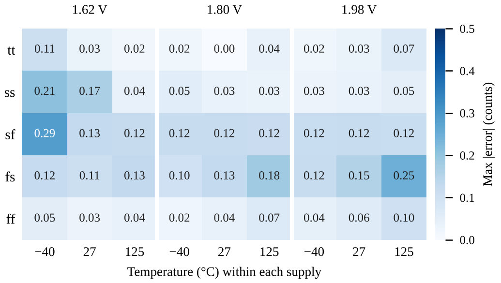
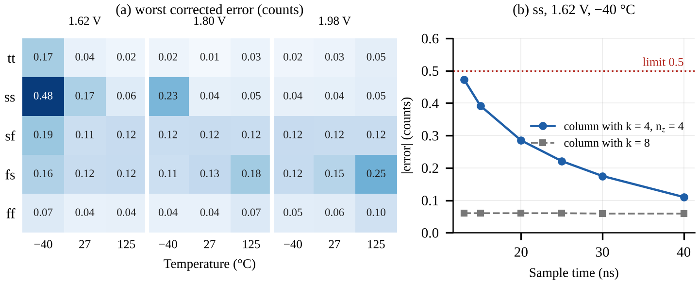
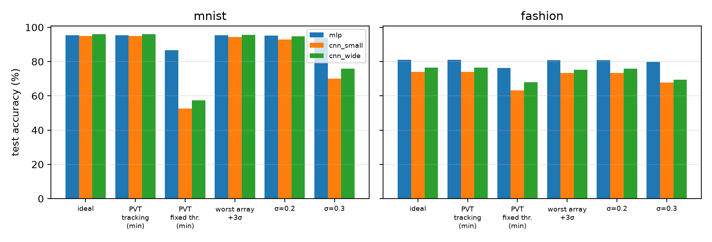

# PVT-Aware Accuracy Characterization of an SRAM-Based Compute-in-Memory Array

An 8T charge-domain SRAM compute-in-memory (CIM) column and 8×4 array in the open **SkyWater SKY130** process, characterized across process, voltage and temperature (PVT) and mismatch with **Xschem + ngspice**, and linked to neural-network accuracy with **PyTorch** error injection. Everything uses open-source tools.


## Design
- **Cell (`sram8t_bitcell`)**: 6T storage core + decoupled read stack (M8 gated by the input RWL, M7 gated by the stored bit) + 10 fF local capacitor + per-cell PMOS precharge + per-cell transmission-gate share switch to the column node CL. All transistors `sky130_fd_pr__nfet_01v8` / `pfet_01v8`, W = 1 µm, L = 0.15 µm. The capacitor is an ideal SPICE capacitor.
- **Column**: 8 cells share CL. With k discharging cells, `V_CL ≈ V0 − (VDD/B)·k`, `B = N + Cpar/C ≈ 9.44`; one count ≈ 190 mV at 1.8 V.
- **Array**: 8 rows × 4 columns. Signed ±1 weights are stored as W+/W− column pairs.
- **Timing**: precharge until 10 ns, RWL pulse from 10.2 ns for T_d = 0.5 ns, share at 11 ns, sample CL at 13 ns.
- **Decoder**: ideal, in Python. The supply-tracking decoder maps V_CL/VDD through the nominal calibration and rounds. No ADC is designed.

## Main results
| Result | Value |
|---|---|
| PVT conditions | 5 corners × {1.62, 1.8, 1.98} V × {−40, 27, 125} °C = 45 |
| Supply-tracking decoder, column | all counts correct; worst error 0.29 counts, mean 0.09 |
| Fixed-threshold decoder | worst error 0.99 counts (fails away from 1.8 V) |
| Input-dependent offset | 0.34–0.51 counts uncorrected, ≤ 0.095 after digital correction |
| Array, 45 conditions × 12 input patterns | 0 misdecodes in 2160 corrected readouts; mean 0.057, worst 0.478 counts |
| Worst array point | ss, 1.62 V, −40 °C, k = 4: slow mid-rail charge sharing (error 0.47 → 0.11 counts from 13 to 40 ns) |
| Mismatch (1σ) | transistor 0.004 counts; capacitor 0.012 counts at an assumed 1 % σ |
| Networks (MLP, CNN, wide CNN; MNIST, Fashion-MNIST) | supply-tracking decoder keeps ideal accuracy in all 45 conditions; fixed thresholds cost up to 42 points |





## Repository layout
```
schematics/   Xschem schematics and symbols (cell, column, 8x4 array, testbenches)
netlists/     text netlists of the cell and an equivalent column subcircuit
testbenches/  ngspice code blocks for the Xschem testbenches (PVT, T_d, Monte Carlo, array, offset, SNM)
analysis/     Python post-processing of the ngspice CSV output
dnn/          binary-network training and CIM error injection (PyTorch)
results/      raw simulation CSVs (spice/) and network results (dnn/)
figures/      figures used in the paper
```

## Reproducing
Requirements: Xschem, ngspice (with SKY130 support), the SKY130A PDK (`/usr/local/share/pdk/sky130A` assumed in the `.lib` lines), Python 3 with numpy, pandas, matplotlib, torch, torchvision.

**Circuit simulations.** Open the testbench schematic in Xschem, paste the matching file from `testbenches/` into its code block, set the corner in the `.lib` line (and `set cname`), netlist and simulate. Each run appends rows to a CSV in ngspice's working directory. Corners are run one at a time (tt, ss, sf, fs, ff).

**Analysis** (CSV formats are documented at the top of each script):
```
python3 analysis/pvt_analysis.py results/spice/pvt_results.csv
python3 analysis/td_analysis.py results/spice/td_results.csv
python3 analysis/delta_analysis.py results/spice/delta_results.csv results/spice/pvt_results.csv
python3 analysis/array_pvt_analysis.py results/spice/array_pvt.csv
```

**Networks:**
```
python3 dnn/cim_dnn.py train
python3 dnn/cim_dnn.py table results/spice/pvt_results.csv
python3 dnn/cim_dnn.py pairs array_pvt_out/per_run.csv
python3 dnn/cim_compare.py train
python3 dnn/cim_compare.py eval results/spice/pvt_results.csv array_pvt_out/per_run.csv
```
Error injection is deterministic except for the Gaussian terms, which use a fixed seed. With zero injected error the mapped network reproduces the floating-point predictions exactly.

## Limitations
Schematic-level simulation only: ideal capacitor, no layout parasitics, ideal control sources, ideal decoder (no ADC). Cell writes are not simulated (weights are loaded with `.ic`). The capacitor mismatch σ is an assumption. The networks are small binary models with binarized inputs.

## License
Code: MIT (see `LICENSE`). Simulation data and figures: CC BY 4.0.
